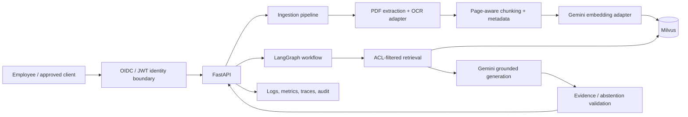

# Banking Knowledge AI — Industry-oriented reference implementation

**Stack:** Gemini embeddings + Gemini generation, LangGraph orchestration, Milvus vector retrieval, FastAPI API, Streamlit demo UI, PyMuPDF extraction with an optional local OCR adapter.

> This is a hardened engineering reference and interview portfolio project, **not a certified production banking system**. The local API-key identity adapter intentionally refuses to start serving authenticated endpoints outside `ENVIRONMENT=local`. A bank must integrate its approved identity provider, data controls, security architecture, platform operations and model-risk processes before production use.

## What changed from the starter demo

- Modular separation: configuration, schemas, identity boundary, document pipeline, AI/vector adapters, LangGraph workflow and API.
- PDF signature/structure checks, bounded upload size/page count, page-aware extraction, optional OCR adapter, content SHA-256, stable document/version metadata and sentence-aware chunk boundaries.
- Ingestion records department, document type, document ID, version, effective date, classification, extraction method, page, chunk ID and content hash.
- Department filtering is derived from the authenticated identity object, **not from a chat request field**. The included local identity is explicitly demo-only.
- Embedding calls validate vector dimensions and use bounded retry/backoff. Milvus inserts are batched.
- Retrieval sources include document ID, filename, version, page and chunk ID. LangGraph generation is instructed to abstain when evidence is absent and cite evidence labels.
- Live/readiness health endpoints, correlation IDs, structured operational log events, API response schemas and starter tests.
- Explicit deployment, privacy, model-risk, evaluation and incident-response checklists.

## Architecture



## Run locally

Prerequisites: Python 3.10+, Docker, a Gemini API key and model access for the configured model IDs.

1. Create environment and install dependencies:

   ```bash
   python -m venv .venv
   # Windows: .venv\\Scripts\\activate
   source .venv/bin/activate
   pip install -r requirements.txt
   ```

2. Configure environment:

   ```bash
   cp .env.example .env
   ```

   Set `GOOGLE_API_KEY` and generate a long random `APP_API_KEY`. Keep `ENVIRONMENT=local` only for local experimentation. Verify that the selected Gemini models are enabled for your account.

3. Start Milvus:

   ```bash
   docker compose up -d
   ```

4. Start the API and UI in separate terminals:

   ```bash
   uvicorn app.main:app --reload --port 8000
   streamlit run app/ui.py
   ```

5. Open `http://localhost:8501`. Upload public or synthetic PDFs only. API docs are at `http://localhost:8000/docs`.

## API

`POST /v1/documents` — multipart upload. Fields: `file`, `department`, `document_type`, `document_id`, `version`, optional `effective_date`, `classification`.

`POST /v1/chat` — JSON body:

```json
{"question":"What is the approval workflow?","top_k":8}
```

Both endpoints require `X-API-Key` in local mode. Do not expose this local adapter to a network or use it as production authentication.

## PDF processing lifecycle

1. **Validate:** enforce byte limit, PDF signature, parseability and page-count limit. File extension alone is not trusted.
2. **Extract:** PyMuPDF extracts text per page in reading order. Pages with little text try the optional local Tesseract adapter if installed; otherwise the response includes a warning. For complex layouts, tables, handwriting or multilingual scans, replace this adapter with a bank-approved document intelligence service or a tested on-prem parser.
3. **Normalize and chunk:** preserve page boundaries and split at sentence/newline boundaries where possible. Each chunk retains document/version/page/hash metadata. Character chunking is a baseline; tune using retrieval evaluation for your corpus.
4. **Embed:** Gemini document embeddings use `RETRIEVAL_DOCUMENT`; query embeddings use `RETRIEVAL_QUERY`. Embedding dimensions are checked. Never mix model versions or dimensions in one collection.
5. **Index:** store dense vectors and metadata in Milvus in bounded batches. For production, add a durable ingestion job queue, transactional metadata store, idempotency, rollback, document lifecycle management and re-index workflows.
6. **Retrieve:** derive department scope from the authenticated identity, filter before returning evidence, and return source metadata. Add document-level ACLs and classification policy enforcement before real banking data.
7. **Generate:** LangGraph passes retrieved evidence to Gemini. The system prompt treats retrieved content as untrusted, requires citations and abstention, and prohibits consequential decisions.
8. **Audit and evaluate:** correlate request IDs; log access and model/retrieval outcomes without logging sensitive prompts or document text by default.

## Security and production-readiness gates

These are mandatory engineering work items, not optional polish:

- **Identity and authorization:** replace `require_demo_identity` with verified OIDC/JWT validation (issuer, audience, signature, expiry, nonce as applicable); map immutable subject/group claims to entitlements. Enforce document-level ACLs and classification labels at retrieval time. Validate uploader role separately from reader role. Never trust caller-supplied department headers or form values as proof of entitlement.
- **Data protection:** private networking, TLS in transit, encryption at rest with managed keys, secrets manager, data residency review, retention/legal hold/deletion, backup/restore tests, DLP, malware scanning and approved provider data-processing terms. Confirm whether external Gemini API use is permitted for the intended data classification; otherwise use an approved enterprise/private deployment.
- **Document governance:** durable catalogue for document owner, source system, version, effective/expiry dates, approval status, superseded state, ACLs and checksum. Prevent duplicate ingestion; support retraction and deletion across vector index, caches and backups. Do not rely on vector metadata as the sole system of record.
- **Parsing quality:** test born-digital PDFs, scanned PDFs, rotated pages, tables, multi-column layouts, headers/footers, multilingual text and malformed files. OCR output must carry confidence and review thresholds. Tables should be represented with row/column context, not flattened blindly.
- **Retrieval quality:** benchmark recall@k, MRR/nDCG, citation precision, answer faithfulness, abstention accuracy and access-control leakage. Add lexical/hybrid retrieval, metadata filters, reranking and query rewriting only when evaluation shows improvement. The current reference uses dense retrieval; it is not hybrid search.
- **Prompt and model security:** indirect prompt-injection tests, malicious PDF fixtures, output schema validation, sensitive-data leakage tests, model/version pinning, safety policies, prompt change review and human approval for high-impact use cases.
- **Reliability:** asynchronous ingestion queue, bounded concurrency, provider quotas, retries with jitter/circuit breaker, timeouts, dead-letter queue, idempotency, graceful shutdown, index migration strategy, load/soak tests, SLOs and disaster recovery.
- **Observability:** OpenTelemetry traces, request/tenant correlation, latency and token metrics, retrieval hit/empty rates, OCR failure rates, model error rates, cost budgets, alerts and immutable audit events. Avoid writing PII, full prompts or retrieved text to ordinary logs.
- **Governance:** model inventory, use-case risk assessment, human oversight, explainability and challenge process, change management, periodic validation, vendor risk and regulatory/legal review.

## Known limitations in this reference

- Local shared API key is only a local demo guard. Production mode returns 503 until a real identity adapter is implemented.
- Department-level filtering is a teaching example; document-level ACLs and classification enforcement are not implemented.
- The Milvus collection is a vector index, not the authoritative document catalogue. Version lifecycle, delete/revoke, deduplication and transactional rollback need a metadata database and lifecycle service.
- Search is dense-only. No BM25/hybrid retrieval, reranker, query expansion or citation verifier is included yet.
- OCR is optional and local. Install Tesseract and Python OCR dependencies, or implement an approved parser adapter. OCR is not automatically guaranteed to work.
- No production-grade secrets manager, distributed tracing, metrics backend, rate limiting, WAF, malware scanner, tenant isolation or deployment manifests are included.
- Gemini model names and API behavior can change; validate availability and pin/test SDK versions in your release process.

## Suggested next engineering increments

1. Implement Entra ID/OIDC validation and policy-based authorization; write negative tests proving cross-department and cross-document access is denied.
2. Add PostgreSQL document catalogue + transactional outbox + queue worker for ingestion, lifecycle and re-indexing.
3. Add hybrid retrieval and reranking, then prove the uplift with a curated evaluation set.
4. Add citation entailment checks and a conditional LangGraph validation/abstention node.
5. Add OpenTelemetry, Prometheus metrics, dashboards, load tests and CI security scanning.
6. Containerize the API, deploy to a private Kubernetes/managed container platform, use managed secrets/identity, and run penetration and disaster-recovery tests.

## Interview discussion points

- Why RAG over fine-tuning for frequently changing circulars and policies?
- How do you prevent retrieval-time authorization leakage?
- How do you manage superseded policy versions and effective dates?
- How do you prove OCR and retrieval quality for tables and scanned circulars?
- What are the acceptance thresholds for groundedness, citation precision and abstention?
- How would you isolate model-provider failure and control token cost?
- What controls prevent an assistant from making credit, fraud or compliance decisions autonomously?
