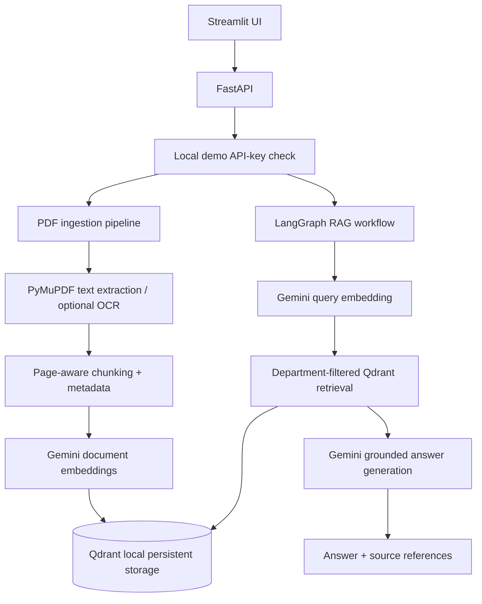

# Banking Knowledge AI — Qdrant Edition

**Stack:** Google Gemini (embeddings + generation) · LangGraph · **Qdrant local persistent vector store** · FastAPI · Streamlit · PyMuPDF.

This edition uses **Qdrant in local persistent mode**. Qdrant runs inside the Python application and stores its data on disk. **Docker, Milvus, etcd and MinIO are not required.**

> **Important:** This is an industry-oriented reference implementation and interview portfolio project, not a certified or production-ready banking system. Use public or synthetic documents only. The included API-key identity mechanism is for local demonstrations; production requires an approved identity provider, authorization policies, security controls, operational controls and model-risk governance.

## 1. Architecture



### Main components

| Component | Responsibility |
|---|---|
| Streamlit | PDF upload and question/answer interface |
| FastAPI | Document-ingestion and chat APIs |
| PyMuPDF | Extract text page by page from PDFs |
| Chunking pipeline | Split extracted text while retaining page and document metadata |
| Gemini Embedding | Convert document chunks and user questions into vectors |
| Qdrant Local | Persist vectors and payload metadata in `data/qdrant/` |
| LangGraph | Orchestrate retrieval and grounded answer generation |
| Gemini Chat | Generate answers from retrieved evidence |

## 2. Prerequisites

- Python **3.11 or 3.12** recommended.
- A Google Gemini API key with access to the configured chat and embedding models.
- Git (optional).
- Windows, macOS or Linux.

Docker is not needed. Python 3.14 may have dependency compatibility issues; use Python 3.11 or 3.12 if installation fails.

## 3. Run on Windows (PowerShell)

Open PowerShell in the project root—the directory containing `requirements.txt` and the `app` folder.

### Step 1 — Create and activate a virtual environment

```powershell
py -3.12 -m venv .venv
.venv\Scripts\Activate.ps1
```

If PowerShell blocks activation in the current window:

```powershell
Set-ExecutionPolicy -Scope Process -ExecutionPolicy Bypass
.venv\Scripts\Activate.ps1
```

### Step 2 — Install dependencies

```powershell
python -m pip install --upgrade pip
pip install -r requirements.txt
```

### Step 3 — Configure environment variables

```powershell
Copy-Item .env.example .env
```

Edit `.env` and set your Gemini API key and a local demo API key:

```dotenv
ENVIRONMENT=local
GOOGLE_API_KEY=replace-with-your-gemini-api-key
GEMINI_CHAT_MODEL=gemini-2.5-flash
GEMINI_EMBEDDING_MODEL=gemini-embedding-001
EMBEDDING_DIMENSION=768
QDRANT_PATH=./data/qdrant
QDRANT_COLLECTION=banking_knowledge_v1
APP_API_KEY=replace-with-a-long-random-secret
MAX_UPLOAD_MB=20
CHUNK_SIZE=1200
CHUNK_OVERLAP=180
RETRIEVAL_TOP_K=8
LOG_LEVEL=INFO
API_URL=http://localhost:8000
```

Keep the real `.env` file private. It is excluded by `.gitignore`; commit `.env.example`, not `.env`.

### Step 4 — Start the FastAPI backend

In terminal 1, from the project root with `.venv` activated:

```powershell
python -m uvicorn app.main:app --reload --host 127.0.0.1 --port 8000
```

Check:

- Liveness: <http://127.0.0.1:8000/health/live>
- Readiness: <http://127.0.0.1:8000/health/ready>
- Swagger API docs: <http://127.0.0.1:8000/docs>

### Step 5 — Start the Streamlit UI

Open terminal 2 in the same project root and activate the same virtual environment:

```powershell
.venv\Scripts\Activate.ps1
streamlit run app/ui.py
```

Open <http://localhost:8501>.

## 4. Run on macOS / Linux

```bash
python3.12 -m venv .venv
source .venv/bin/activate
python -m pip install --upgrade pip
pip install -r requirements.txt
cp .env.example .env
# Edit .env and set GOOGLE_API_KEY and APP_API_KEY
python -m uvicorn app.main:app --reload --host 127.0.0.1 --port 8000
```

In a second terminal:

```bash
source .venv/bin/activate
streamlit run app/ui.py
```

## 5. How Qdrant local storage works

The application initializes Qdrant in `app/services.py` using the local path configured by `QDRANT_PATH`:

```python
QdrantClient(path=settings.qdrant_path)
```

On first startup, the application creates the collection named by `QDRANT_COLLECTION` with the configured embedding dimension and cosine distance metric. On document ingestion, vectors and their metadata are upserted into that collection. On chat, the query vector is searched with a department filter.

Default local data directory:

```text
data/
└── qdrant/
```

- The directory is created automatically when Qdrant opens it.
- Keep this directory to retain the locally indexed vectors and payloads.
- Back it up while the application is stopped; do not copy an actively written database directory as a backup.
- Do not delete it unless you intend to remove the local vector index and re-ingest your documents.
- Qdrant local persistent mode uses a local storage lock. Do not start multiple API processes or multiple application instances against the same `QDRANT_PATH` at the same time.
- This local mode is intended for development and single-process demonstrations. For multi-user or highly available deployment, evaluate Qdrant Server/Cluster or another managed/distributed vector database and design backup, access control and operations accordingly.

## 6. Document ingestion and RAG flow

1. **Upload:** The UI sends a PDF to `POST /v1/documents`.
2. **Validate:** The pipeline checks PDF structure and upload limits.
3. **Extract:** PyMuPDF extracts text page by page. Scanned PDFs may require the optional OCR adapter and local Tesseract installation.
4. **Chunk:** Text is split into chunks while retaining document, version, page and department metadata.
5. **Embed:** Gemini creates document embeddings using the configured embedding model and dimension.
6. **Index:** Qdrant stores vectors and payload metadata in the local collection.
7. **Question:** The UI sends a question to `POST /v1/chat`.
8. **Retrieve:** LangGraph creates a query embedding and retrieves matching Qdrant points, applying the current department filter.
9. **Generate:** Gemini generates an answer from retrieved evidence; the response includes source references where available.

The current parser is a baseline. Complex tables, multi-column layouts, handwriting, poor-quality scans and multilingual PDFs require additional parsing/OCR evaluation.

## 7. API reference

All protected API calls require this header in local mode:

```http
X-API-Key: <the APP_API_KEY value from .env>
```

### `POST /v1/documents`

Multipart form fields:

- `file` — PDF file
- `department` — e.g. `OPERATIONS`, `RISK`, `COMPLIANCE`, `HR`, `PUBLIC`
- `document_id` — stable document identifier
- `version` — document version
- `document_type` — optional; defaults to `POLICY`
- `effective_date` — optional date
- `classification` — optional; defaults to `INTERNAL`

### `POST /v1/chat`

JSON request body:

```json
{
  "question": "What is the approval workflow described in this policy?",
  "top_k": 8
}
```

Use Swagger at <http://127.0.0.1:8000/docs> to inspect request and response schemas.

## 8. Troubleshooting

| Symptom | Checks / action |
|---|---|
| `ModuleNotFoundError: No module named 'app'` | Run commands from the project root—the folder containing `app/` and `requirements.txt`. Confirm `app/main.py` exists. |
| `401 Unauthorized` on `/v1/documents` or `/v1/chat` | Check that `.env` has `APP_API_KEY`, restart FastAPI after editing it, and ensure Streamlit reads the same key. The request header must be `X-API-Key`. |
| `GOOGLE_API_KEY is not configured` | Check `.env` is in the project root and contains `GOOGLE_API_KEY`; restart the backend. |
| Gemini model or embedding error | Verify the model IDs are available to your API key and that the embedding dimension matches the configured model response. |
| Qdrant local storage is locked | Stop other API/application processes using the same `QDRANT_PATH`, then restart one backend process. |
| No text extracted from a PDF | The PDF may be scanned. Configure the optional OCR adapter and Tesseract, or use a tested document parser. |
| Port 8000 is already in use | Stop the process using the port or choose another port and update `API_URL` accordingly. |
| `pip` dependency installation errors | Use Python 3.11 or 3.12, recreate `.venv`, upgrade pip and reinstall requirements. |

## 9. Security notes and known limitations

- The local API key is a demonstration guard, not enterprise identity. The current identity adapter must not be exposed as production authentication.
- The demo identity grants a fixed set of departments. Department filtering is not equivalent to document-level authorization. The `clearance` parameter is not currently enforced in the vector search implementation.
- Do not use real customer information, confidential bank documents or regulated data with this demo. Confirm provider approval, data-processing terms and data residency before any real enterprise use.
- The Qdrant collection is a vector index, not the authoritative document catalogue. Production needs a durable metadata store, document lifecycle/version management, deletion/revocation and re-indexing workflows.
- Current retrieval is dense-vector retrieval with a department filter. Hybrid BM25/vector search, reranking and citation verification are not implemented.
- Production hardening should include verified OIDC/JWT authentication, document-level ACLs, encryption, private networking, secrets management, malware scanning, rate limiting, audit trails, observability, evaluation, backup/restore, resilience and security testing.

## 10. Suggested next improvements

1. Add Entra ID/OIDC authentication and document-level authorization tests.
2. Add PostgreSQL as the authoritative document catalogue and lifecycle store.
3. Add hybrid retrieval (lexical + vector) and reranking, evaluated against a curated test set.
4. Add citation validation and a LangGraph evidence-validation/abstention node.
5. Add OpenTelemetry traces, metrics, dashboards, cost monitoring and CI security scanning.
6. Evaluate Qdrant Server/Cluster or a managed vector database for multi-user, high-availability deployments.

## 11. Interview discussion points

- Why use RAG rather than fine-tuning for frequently changing policies and circulars?
- How would you enforce document-level authorization before evidence reaches the LLM?
- How would you handle superseded policy versions and effective dates?
- How would you measure retrieval recall, citation precision, groundedness and abstention?
- When would you move from Qdrant local mode to Qdrant Server/Cluster?
- How would you manage prompt injection, provider outages, token costs and auditability?
